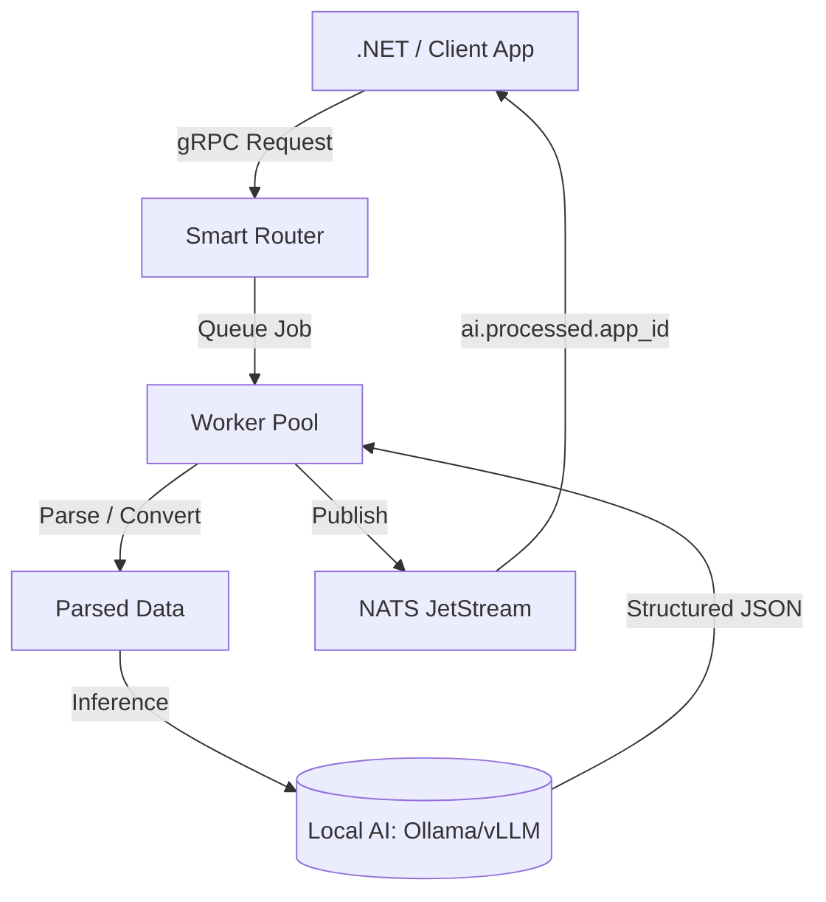

# Local AI Document Processing Service

Welcome to the Local AI Document Processing Service. This is a blazing-fast, highly-concurrent, 100% local Go microservice that processes documents (PDFs, DOCX, and Images) and uses local AI models to extract structured JSON metadata. It serves as an asynchronous event-driven gateway using NATS JetStream.

## Documentation Index
- [Core Components](./docs/01_Core_Components.md)
- [How To Implement](./docs/02_How_To_Implement.md)
- [Service Communication](./docs/03_Service_Communication.md)

## High-Level Architecture

